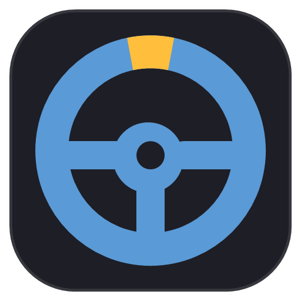

<p align="center">
  
</p>
<h3 align="center">Steer racing games with your mouse — no wheel needed.</h3>

MouseDrive turns left and right mouse movement into a steering axis. It talks to the game through
**vJoy**, a free virtual joystick, so the game sees an ordinary controller. It is meant for racing
games without mouse steering of their own.

> **Early development.** Steering and progressive pedals work; feel tuning and
> per-game setup guides are next.

## Highlights

- **Mouse = wheel.** Movement is read straight from the mouse (Raw Input), so the pointer
  position, screen size and Windows pointer acceleration don't matter.
- **Tune the feel.** Sensitivity, expo, deadzone, smoothing and optional self-centering, with a
  live ruler of mouse travel against wheel lock.
- **Pointer stays put.** While driving it is held in the middle of the main screen and hidden.
- **Extra buttons.** Map keys or mouse buttons (right, middle, 4, 5) to vJoy buttons for
  shifting, pit limiter, lights…
- **Progressive pedals.** Throttle, brake and clutch from keys or mouse buttons, with initial
  and maximum force, adjustable apply/release rates, a response graph and live meters.
- **On-screen HUD.** Wheel or bar, click-through, with size, opacity and position.
- **Profiles per car or game**, with import and export.

## Quick start

1. Install [vJoy](https://github.com/jshafer817/vJoy/releases) and, in **Configure vJoy**, enable
   Device 1 with the **X** axis and 16 buttons. Add **Y**, **Z** and **Rz** for virtual pedals.
2. Run `MouseDrive.exe` (needs the .NET 8 Desktop Runtime, x64).
3. Bind the game's steering to the vJoy device, press **F9** and drive.

The full guide is [MouseDrive_Manual.md](MouseDrive/MouseDrive_Manual.md), also copied next to the exe.

## Build

```powershell
dotnet build MouseDrive\MouseDrive.csproj -c Release
```

Needs the .NET 10 SDK; the app targets .NET 8.

## Regression checks

```powershell
dotnet run --project MouseDrive.Tests -c Release
```

Runs the binding, pedal and profile regression checks on Windows, using the app's forms and in-memory
substitutes for vJoy and the global hooks. It does not activate driving or require the vJoy driver.
Test profiles and settings stay in the test build output folder.
