<p align="center">
  
  
  
  <a href="https://github.com/rangelsantos/MouseDrive/releases/latest"></a>
  <a href="https://ko-fi.com/rangelsantosss"></a>
</p>

<p align="center">
  
</p>
<h3 align="center">Steer racing games with your mouse — no wheel needed.</h3>

<p align="center">
  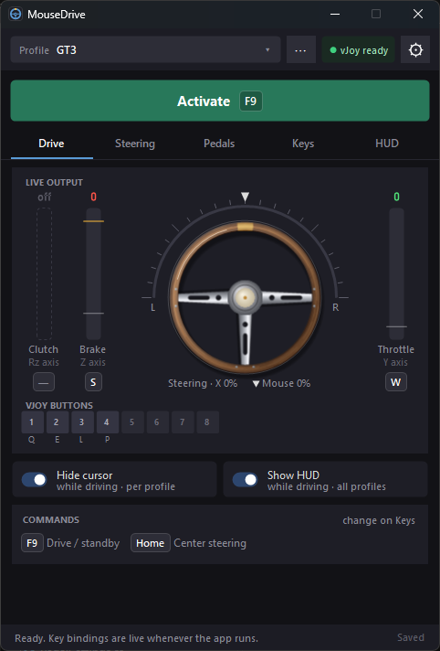
</p>

MouseDrive turns left and right mouse movement into a steering wheel. Keys or mouse buttons work
the throttle, brake and clutch as progressive pedals. It talks to the game through **vJoy**, a free
virtual joystick, so the game sees an ordinary controller. It is made for racing games without
mouse steering of their own.

> **Early development.** Steering, pedals and the HUD work; setup guides per game are next.
> **[Download the latest release](https://github.com/rangelsantos/MouseDrive/releases/latest)**.

---

## Highlights

- **Mouse = wheel.** Movement is read straight from the mouse (Raw Input), so the pointer
  position, screen size and Windows pointer acceleration don't matter.
- **Tune the feel.** Sensitivity, expo, deadzone, smoothing and optional self-centering, with a
  live ruler of mouse travel against wheel lock.
- **Progressive pedals.** Throttle, brake and clutch from keys or mouse buttons, each with an
  initial and a maximum force and its own press and release times.
- **Extra buttons.** Map keys or mouse buttons (right, middle, 4, 5) to vJoy buttons for
  shifting, pit limiter, lights…
- **On-screen HUD.** Four styles drawn over the game, click-through. The wheel turns as far as the
  game's (180° to 1080°, per profile), and a position bar shows where it is past a full turn.
- **Profiles per car or game.** Each keeps its own feel, rotation, pedals and keys. Import and
  export them to share.
- **Pointer stays put.** While driving, it is held in the middle of the main screen and hidden, so
  it can't slip onto another window or monitor.
- **Stays out of the way.** Compact window, close to tray, and the icon shows a red dot while
  you're driving.

---

## A quick tour

### Drive — what the game is receiving

The Drive tab, shown at the top of this page, is the live view. The wheel turns with the steering
sent to the game, over a scale of the axis from full left to full right; the white triangle is the
mouse before deadzone, expo and smoothing. Clutch and brake stand on the left and the throttle on
the right, each with its force, its vJoy axis and its key. The vJoy button lamps light up while
their keys are down.

Press **F9** or click **Activate** to start driving with the mouse. Press **F9** again for standby:
the wheel centers and the mouse is yours again. **Home** straightens the wheel while you drive.

The chip at the top right checks vJoy for you: green **vJoy ready** means all set; click it when
it's amber or red to see what's missing. The **⚙** menu next to it holds the window options
(always on top, close to tray, compact window) and **About**, with the version and links to this
repository, its releases and the manual.

### Steering — make it respond your way

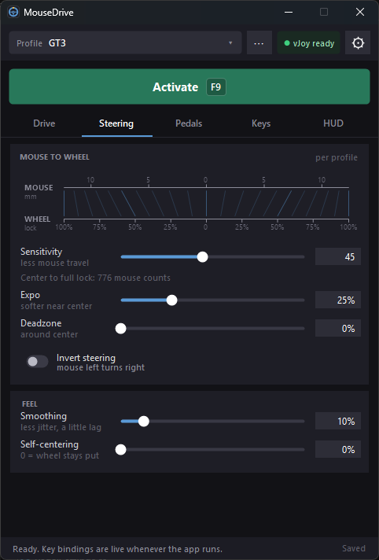

**Mouse to wheel** shows two rulers: mouse travel from center in millimeters above, wheel lock
below, joined at every 10% of lock. Move **Sensitivity** and see how far the mouse has to go for
full lock; with **Expo** the lines bunch toward the ends, for finer control near center.

**Feel** adds **Smoothing** against jitter and **Self-centering**, which brings the wheel back to
center when the mouse stops, a bit like a real car.

<br clear="right">

### Pedals — progressive throttle, brake and clutch

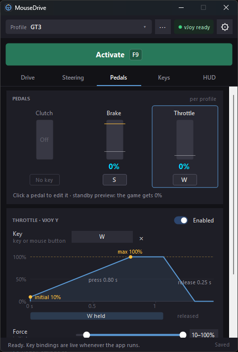

A key is on or off; a pedal isn't. Each pedal jumps to its **initial force** when you press the
key, climbs to its **maximum force** in the **press time** and goes back to zero in the
**release time**. The graph draws one key press with every setting labeled where it acts.

Hold a pedal key in standby to watch the bars move while the game still gets 0%. Throttle, brake
and clutch go to the vJoy **Y**, **Z** and **Rz** axes.

<br clear="right">

### Keys — vJoy buttons

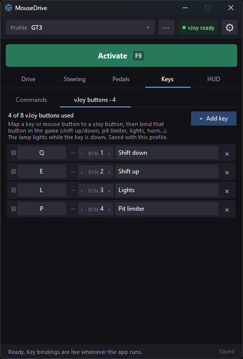

Click **+ Add key**, press a key or a mouse button (right, middle, 4 or 5), pick the vJoy button
number and give it a name. Then bind that button in the game's controls.

**Commands** holds the drive/standby and center keys. Click a key and press the new one: **Esc**
cancels, **Backspace** clears, and conflicts are caught before they happen.

<br clear="right">

### HUD — your wheel and pedals, over the game

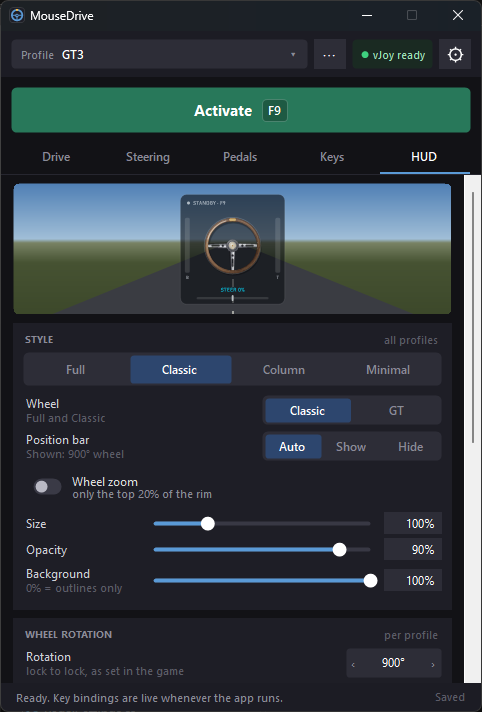

A small click-through display drawn over the game: the wheel, the pedals and whether you're
**DRIVING** or in **STANDBY**. Choose the style and the wheel, the size, opacity and background,
then drag it wherever you like with **Position HUD…**. It never takes the focus from the game.

Set **Wheel rotation** to the game's steering rotation (900° is common) and the HUD wheel turns
like the one in the game. Past one full turn, +45° and +405° look the same, so the **position
bar** shows where the wheel really is. **Show status** hides the status and the profile name for an
even smaller HUD.

It also flashes **DRIVING**, **STANDBY** or **CENTER** when you press the keys, so you know it
worked with the window hidden behind the game.

<br clear="right">

| Full | Classic |
|:---:|:---:|
| 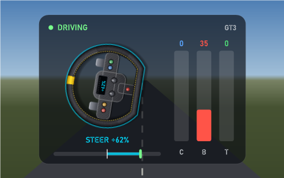 | 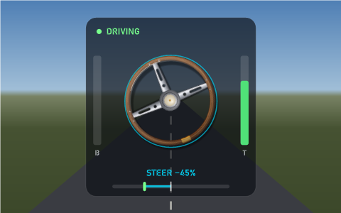 |
| **Column** | **Wheel zoom, without status or background** |
| 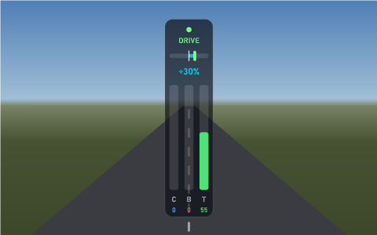 | 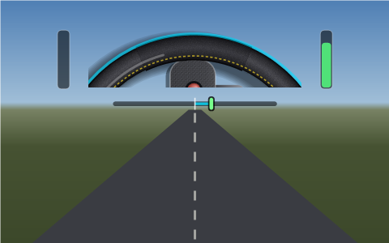 |
| **Minimal** | |
| 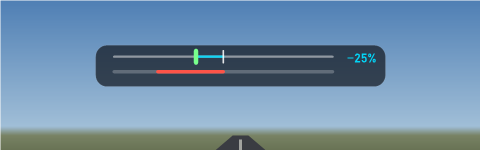 | |

### Compact window and tray

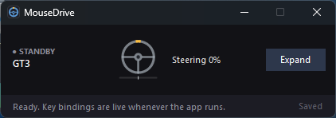

Shrink MouseDrive to a strip with just the essentials (**⚙ → Compact window**), for a second
screen, or drag the full window shorter on a small screen (the tabs scroll and the height is
remembered). With **Close to tray**, closing the window keeps it running with your keys working.
A red dot on the icon, in the tray and on the taskbar, means you're driving.

---

## Default keys

| Key | Action |
|---|---|
| **F9** | Start / stop driving with the mouse |
| **Home** | Center steering |
| *not set* | Throttle, brake and clutch (on the Pedals tab) |
| *not set* | vJoy buttons (on the Keys tab) |

All of them can be changed per profile. Keys work in every app, so the game doesn't need the focus
for MouseDrive to hear them.

---

## Getting started

1. **Install vJoy** from [github.com/jshafer817/vJoy/releases](https://github.com/jshafer817/vJoy/releases)
   and restart if asked.
2. **Configure vJoy** (once): open *Configure vJoy*, select **Device 1**, tick **X** (steering)
   and, for pedals, **Y**, **Z** and **Rz**; set **16** buttons and apply.
3. **Start MouseDrive** from the [latest release](https://github.com/rangelsantos/MouseDrive/releases/latest)
   (`MouseDrive.exe`). The chip at the top right should say **vJoy ready**.
4. **Bind the steering in the game** (once): start binding the steering axis, press **F9**, move
   the mouse left or right, and press **F9** again. Set the game's steering deadzone to 0 and its
   linearity to 1.0.
5. **Match the rotation**: set **Wheel rotation** on the HUD tab to the game's steering rotation.

Run the game in **windowed** or **borderless** mode while you set things up.

📖 The full **[user manual](MouseDrive/MouseDrive_Manual.md)** covers every option; it is also
copied next to the exe.

## Requirements

- Windows 10 or 11, 64-bit
- [.NET 8 Desktop Runtime](https://dotnet.microsoft.com/download/dotnet/8.0) (x64)
- [vJoy](https://github.com/jshafer817/vJoy/releases), device 1 with the X axis (and Y, Z, Rz for
  pedals)
- A racing game that accepts a generic joystick or wheel (DirectInput)

## Build

```powershell
dotnet build MouseDrive\MouseDrive.csproj -c Release
```

Needs the .NET 10 SDK; the app targets .NET 8.

### Regression checks

```powershell
dotnet run --project MouseDrive.Tests -c Release
```

Runs the binding, pedal, HUD and profile regression checks on Windows, using the app's forms and
in-memory substitutes for vJoy and the global hooks. It does not activate driving or require the
vJoy driver. Test profiles and settings stay in the test build output folder.

## Credits

MouseDrive is created by **Rangel Santos**, as a racing spin-off of
[MouseYokeEnhanced](https://github.com/rangelsantos/MouseYokeEnhanced), the mouse yoke for Flight
Simulator. Joystick output goes through [vJoy](https://github.com/jshafer817/vJoy).

If MouseDrive makes your laps better, you can [buy me a coffee](https://ko-fi.com/rangelsantosss) ☕
on Ko-fi.

<p align="center">See you on track! 🏁</p>
